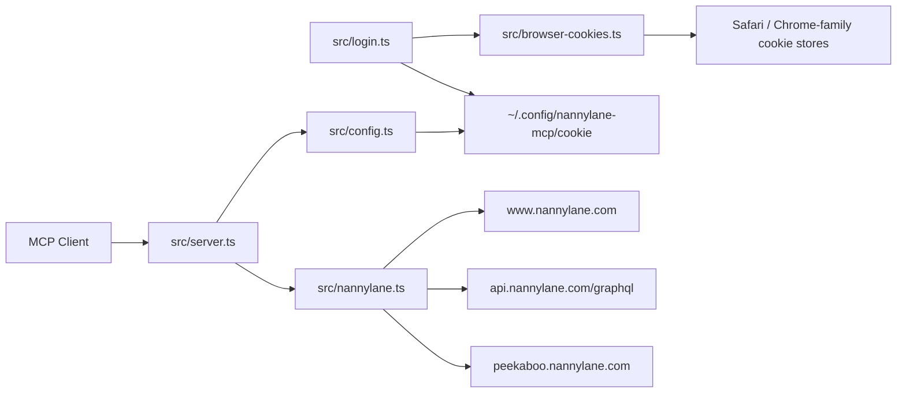

# Architecture

## Components

## File Map

`src/server.ts`
: MCP stdio server. Registers tools and converts client responses to MCP text content.

`src/config.ts`
: Loads auth and runtime configuration. Credential loading is lazy through server tool handlers.

`src/nannylane.ts`
: Nanny Lane client. Owns HTTP headers, GraphQL calls, Next.js data routes, listing extraction, message queries, and message mutation calls.

`src/login.ts`
: Local credential setup CLI. Opens login, accepts pasted cookies, imports browser cookies, validates auth, and writes the cookie file.

`src/browser-cookies.ts`
: macOS browser-cookie import. Supports Safari binary cookies and Chrome-family SQLite cookies.

`test/nannylane.test.ts`
: Unit coverage for route normalization, payload extraction, login helper parsing, and cookie-header construction.

## Request Flow

1. MCP client starts `bun /path/to/src/server.ts`.
2. Server registers all tools without requiring auth.
3. A tool handler calls `getClient()`.
4. `loadConfig()` resolves cookies from env or the default cookie file.
5. `NannyLaneClient` sends browser-like headers to the relevant Nanny Lane endpoint.
6. Tool returns JSON as text content.

## Endpoint Families

The client wraps three endpoint families:

- `www.nannylane.com` for dashboard HTML, Next.js data, plan pages, and public directory pages.
- `api.nannylane.com/graphql` for persisted and non-persisted GraphQL operations.
- `peekaboo.nannylane.com` for feature-bucketing checks.

See [Endpoint Map](endpoint-map.md) for route-level detail.

## Auth Flow

1. User runs `bun run login:safari`, `bun run login:chrome`, or `bun run login`.
2. Login helper obtains a cookie header.
3. Helper validates the cookie against the dashboard recommendations page.
4. Helper writes the cookie file with `0600` permissions.
5. Server reads the file on future tool calls.

## Browser Cookie Import

Safari:

- Reads `Cookies.binarycookies`.
- Parses pages and cookie records directly.
- Filters to `nannylane.com` hosts.
- Does not need Keychain decryption for standard Safari cookie values.

Chrome-family browsers:

- Finds local profile cookie databases.
- Copies each SQLite database to a temp directory before reading.
- Reads `host_key`, `name`, `value`, and `encrypted_value`.
- Uses macOS Keychain safe-storage secrets.
- Decrypts `v10`/`v11` AES-CBC cookie payloads.
- Filters to `nannylane.com` hosts.

## Design Decisions

Lazy auth loading
: The MCP server should start even before login is configured. This improves installability and tool discovery.

Cookie file outside the repo
: Auth state belongs in user config, not project source.

Dry-run message default
: Sending a message is an external side effect. The default must be inspectable and non-sending.

Small client surface
: The code wraps known request shapes rather than trying to be a general Nanny Lane SDK.

No checked-in fixtures from real accounts
: Tests use synthetic ids and HTML snippets only.

## Data Sensitivity

The following data can be sensitive:

- Cookie headers
- Cloudflare clearance values
- Session ids
- User ids
- Profile data
- Conversation text
- Subscription state
- Nanny/family listing ids when tied to real people

Do not put real values in docs, tests, issue comments, or commit messages.

## Error Model

The client intentionally throws plain errors with truncated response bodies. This keeps MCP responses useful during local debugging while reducing the chance that large HTML pages or personal data are copied wholesale into logs.

Network calls use `AbortSignal.timeout()` with `NANNYLANE_TIMEOUT_MS`, defaulting to 20 seconds.
